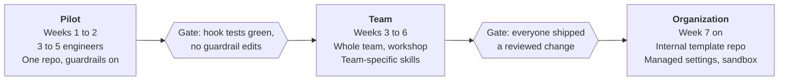

# Claude Code Team Kit: Rollout & Usage Guide

Nov 9, 2026 · Magesh

## Overview

The best way to adopt this kit is a two-week pilot with 3 to 5 engineers on one real repository, with every guardrail switched on, before rolling it out to the team. The kit gives you the pieces; the pilot tells you which ones fit your codebase.

The kit is a small Node.js shopping-cart library wrapped in a team-ready Claude Code setup. The library is only a demo. What you copy into your own repos is the setup around it:

| Piece | Path | What it does for the team |
| --- | --- | --- |
| Shared context | `CLAUDE.md` | Commands, conventions and working agreements Claude reads every session |
| Permissions | `.claude/settings.json` | What Claude may run without asking, and what it may never run |
| Guardrail hooks | `.claude/hooks/` | Code that blocks risky edits and shell commands, and runs tests after edits |
| Skills | `.claude/skills/` | Repeatable workflows: `/review`, `/test-plan`, `/onboard`, `/pr-summary` |
| Subagent | `.claude/agents/security-reviewer.md` | A read-only second opinion on security |
| Hook tests and CI | `test/hooks.test.js`, `.github/workflows/ci.yml` | Proof the guardrails work, on every push |
| Docs | `docs/RESPONSIBLE-USE.md`, `docs/WORKSHOP.md` | Policy and limits, plus a 60-minute onboarding session |

Three principles run through all of it: enforce policy with code rather than prompts, verify with tests rather than trust, and keep a human accountable for every change.

## Recommended rollout plan

Roll out in three phases, and move to the next only when its gate is met. Each phase widens who uses the kit, never what the kit allows.

Start with the pilot; the gates must hold before more people join.

**Phase 1: Pilot (weeks 1 to 2).** 3 to 5 volunteer engineers, one repository, guardrails as shipped.

- Copy the kit into the repo (see Setup) and adapt `CLAUDE.md`.
- Each pilot engineer runs the workshop exercises, then uses Claude Code for real tickets.
- Keep a shared log of blocked commands, false positives and missing conventions.
- **Gate:** hook tests and CI green; no guardrail edited to unblock work; a short list of `CLAUDE.md` and permission changes agreed.

**Phase 2: Team (weeks 3 to 6).** The whole team on the pilot repo, then on its other repos.

- Run the 60-minute workshop for everyone.
- Merge the pilot's changes through normal code review.
- Add one or two team-specific skills for your most repeated tasks.
- **Gate:** every engineer has shipped at least one reviewed change made with Claude Code; the false-positive log is shrinking.

**Phase 3: Organization (week 7 on).** Other teams fork the setup.

- Publish your adapted kit as an internal template repository.
- Name an owner per team for its `CLAUDE.md` and settings.
- Consider managed settings for policies that no repo should be able to loosen.
- Turn on Claude Code's sandbox where you need hard network and filesystem isolation.

What not to do: skip the pilot, start with permissive settings and tighten later, or let each engineer keep a private setup. All three make problems invisible until they are expensive.

## Setting up the kit in your repository

Setup takes about an hour for one repository: copy five things, adapt two files, and prove the guardrails work before anyone uses them.

1. **Try the kit as-is first.** Clone it, run `npm test` (Node 18 or later), start `claude`, and run `/onboard`. This shows the intended behavior before you change anything.
2. **Copy the setup into your repo:** `.claude/` (settings, hooks, skills, agents), `CLAUDE.md`, `test/hooks.test.js`, `scripts/check-syntax.js` if you want it, and the CI workflow.
3. **Rewrite `CLAUDE.md` for your codebase.** Replace the commands, conventions and working agreements with yours. Keep it short: one screen is better than three.
4. **Adapt `.claude/settings.json`.**
   - `allow`: your real test, lint and build commands, plus read-only git.
   - `deny`: keep the secrets, network and push rules; add anything specific to you, such as deploy scripts or database clients.
5. **Point the test hook at your layout.** `test-after-edit.js` runs tests only for files under `src/` and `test/`. Change the path pattern and the test command if yours differ, and raise its timeout if your suite is slow.
6. **Run the hook tests, then add cases** for any patterns you changed. A guardrail without a test will regress silently.
7. **Add CI** so tests and hook tests run on every push and pull request.
8. **Check `.gitignore`** includes `.claude/settings.local.json` and your secrets files.
9. **Open a pull request** with the setup and have it reviewed like any other change.

Node is required to run the hooks even if your project is not JavaScript. If that is a problem, port the three hook scripts to a language your machines already have; they are under 60 lines each.

## Daily workflow for engineers

The habit that matters most is plan, build, review: let Claude propose before it edits, let the tests judge the edit, and read the diff yourself before it leaves your machine.

1. **Orient.** New to a repo? Run `/onboard` for a five-minute tour.
2. **Plan.** For anything beyond a one-line fix, switch to plan mode (Shift+Tab) and ask for a plan. Correct the plan, not the code. For new tests, run `/test-plan <file>` and approve the cases first.
3. **Build.** Leave plan mode and let Claude implement. After each edit to source or tests, the test hook runs the suite and feeds failures straight back, so Claude fixes them before you see them.
4. **Review.** Run `/review` on your uncommitted changes, including new files. For changes that touch input handling, auth, secrets or external calls, also ask for the `security-reviewer` subagent.
5. **Ship.** Commit on a branch, then run `/pr-summary` for a draft description. You push and merge yourself; the kit blocks Claude from pushing.

| Skill | When to use it | What it touches |
| --- | --- | --- |
| `/onboard` | First day in a repo | Reads files only |
| `/test-plan <file>` | Before writing tests | Reads files only; waits for approval |
| `/review` | Before every commit | Reads the diff and new files; changes nothing |
| `/pr-summary [base]` | Before opening a PR | Reads git log and diff against the base branch (default `main`) |

When a guardrail blocks something, read the message. If the block is right, change the approach. If it is a false positive, run the command yourself with `!` and log it for the kit owner; never ask Claude to edit the hooks.

## Guardrails and their limits

The guardrails stop accidents and casual mistakes reliably, but they match text, so they are not a security boundary. Only the sandbox is that. Tell your team both halves.

| Layer | What it enforces | Known limit |
| --- | --- | --- |
| `CLAUDE.md` working agreements | Run tests, small diffs, ask when unclear, never touch secrets or push | A request, not enforcement; Claude can still get it wrong |
| Permission `allow` / `deny` rules | Only approved commands run unprompted; secrets reads, `curl`, `wget`, `git push` and `WebFetch` are denied | Rules match command prefixes, so `git -C . push` or `cat .env` slip past them |
| `protect-files.js` (before edits) | Blocks edits to secrets files, `.git/`, the lockfile, settings and the hooks themselves | Covers the edit tools only; shell writes are the next layer's job |
| `guard-bash.js` (before shell commands) | Blocks commands that touch secrets, push, use network tools, or write to settings and hooks | Pattern matching: obfuscated commands can evade it, and it blocks some harmless ones |
| `test-after-edit.js` (after edits) | Runs the tests after each source or test edit and feeds failures back | Only as good as your tests |
| CI | Lint, tests and hook tests on every push and PR, Node 18 to 24 | Runs after the fact, not during the session |
| Human review | Every change read and approved by a person | Depends on people actually reading the diff |
| Sandbox (optional) | OS-level limits on files and network | Must be switched on deliberately; not every platform supports it |

**Expected false positives.** `guard-bash.js` will block `git log --grep push`, any command that mentions a secrets file, and commit messages or scripts containing a network tool's name. That is deliberate: the cost of a false block is a manual command; the cost of a missed one could be a leaked secret.

**Hooks fail open** on malformed input so a broken hook never freezes a session. Permissions still apply in that case.

**Personal settings can loosen rules.** `.claude/settings.local.json` is per developer and not committed. The hooks stop Claude from editing it, but a person can still widen access there. If that is not acceptable, use managed settings.

## Customizing for your stack

Change `CLAUDE.md` freely and often; change permissions and hooks rarely, deliberately, and always with a test.

**`CLAUDE.md`: write what a new hire would get wrong.**

- Exact commands for test, lint, build and running one test.
- Rules that are not obvious from the code, such as "money is integer cents" or "all dates are UTC".
- What is off limits: generated files, vendored code, migrations that need a DBA.
- Leave out what the code already shows. Every line costs context in every session.

**Permissions: widen deliberately.**

- Add to `allow` only commands that are read-only or easily undone, such as your test runner, linter and type checker.
- Keep `git push`, deploy tools, database clients and cloud CLIs out of `allow`. Add the dangerous ones to `deny`.
- Personal conveniences go in `.claude/settings.local.json`, never in the shared file.

**Hooks: extend the pattern lists, not the logic.**

- Add your own sensitive paths to `PROTECTED` in `protect-files.js`, such as `infra/prod/` or `*.pem`.
- Add your own risky commands to `RULES` in `guard-bash.js`, such as `kubectl`, `terraform apply` or `psql`.
- Add a block case and an allow case to `test/hooks.test.js` for every pattern you add.

**Skills: capture what you repeat.** Good candidates are tasks a senior engineer explains more than twice a month. Examples: "add a database migration", "add an API endpoint with tests", "triage a flaky test". Create `.claude/skills/<name>/SKILL.md` with a clear `description` so Claude can also pick it up on its own, and limit its `allowed-tools` to what the task needs.

**Subagents: add reviewers, not builders.** Read-only specialist reviewers (performance, accessibility, API compatibility) add a second opinion cheaply. Keep their tools limited, as `security-reviewer` does.

## Governance

Give the kit one named owner per team, and treat every change to it as a code change: a branch, a pull request, a reviewer.

| Change | Who can make it | Review needed |
| --- | --- | --- |
| `CLAUDE.md` wording, new conventions | Any engineer, with Claude's help | One teammate |
| New or changed skill | Any engineer | One teammate; the kit owner if it widens `allowed-tools` |
| Permission `allow` rules | A human, by hand | Kit owner |
| Permission `deny` rules, hooks | A human, by hand; hooks block Claude from editing them | Kit owner plus a second reviewer; hook tests must pass |
| Org-wide policy | Platform or security team | Via managed settings, outside any repo |

The owner's recurring jobs:

- [ ] Review the false-positive log every two weeks and tune patterns, with tests.
- [ ] Review `CLAUDE.md` once a month and remove anything stale or obvious from the code.
- [ ] Check new Claude Code releases for features that replace a hand-written hook or rule.
- [ ] Re-run the workshop for each new joiner, or pair them with a pilot engineer.

Keep the "what not to delegate" list from `docs/RESPONSIBLE-USE.md` visible: security posture, merging and releasing, real credentials, production data, and the guardrails themselves stay with people.

## Running the onboarding workshop

Run the 60-minute workshop in `docs/WORKSHOP.md` on the kit's demo repo, not your production code, so people can try to break things safely.

| Time | Segment | What participants do |
| --- | --- | --- |
| 0 to 10 min | Orientation | Tour `CLAUDE.md` and `.claude/`; learn shared versus personal settings |
| 10 to 20 min | Explore and plan | `/onboard`, `/test-plan src/cart.js`, plan mode for a FREESHIP code |
| 20 to 35 min | Build with guardrails | Implement it; watch tests run after edits; see edits to secrets and pushes blocked |
| 35 to 45 min | Probe the guardrails | In pairs, try bypasses such as `git -C . push`; read the Limits section |
| 45 to 52 min | Review | `/review`, then the security-reviewer subagent; reject one finding and say why |
| 52 to 60 min | Debrief | What to adopt, adapt, and never delegate |

Facilitator tips:

- Ask everyone to install Claude Code and clone the repo before the session; setup problems eat the first 15 minutes otherwise.
- 6 to 10 people per facilitator works well; pairs work better than solo for the probing exercise.
- The FREESHIP prompt is deliberately underspecified: the cart has no shipping. Praise anyone whose Claude asked a question instead of inventing a shipping model.
- End by having each person open a small PR improving `CLAUDE.md`. It makes the setup feel owned, not imposed.

## Measuring success

Judge the rollout on quality and safety first and speed second: a faster team that ships more bugs has not improved. Take a baseline in the two weeks before the pilot so you have something to compare against.

| Signal | How to measure | Healthy direction |
| --- | --- | --- |
| Change quality | Bugs or reverts traced to merged PRs, per month | Flat or down |
| Review load | Review comments per PR; time from PR open to merge | Down, without fewer reviewers |
| Test discipline | Share of PRs that add or change tests | Up |
| Guardrail health | Blocks per week, and how many were false positives | False positives falling over time |
| Guardrail integrity | Hook tests and CI passing; any hook or settings change made without review | Always green; zero unreviewed changes |
| Adoption | Engineers who used Claude Code on a merged change this month | Up through phase 2 |
| Sentiment | A three-question survey at the end of each phase | Improving; read the free-text answers |

Watch for warning signs: people working around the guardrails rather than reporting them, review comments getting shorter while PRs get bigger, or `CLAUDE.md` going untouched for months.

## Troubleshooting and FAQ

Most problems come from three places: a hook pattern that is too broad, a slow test suite, or a hook change that never got picked up.

| Symptom | Likely cause | Fix |
| --- | --- | --- |
| A harmless command is blocked: "uses a network tool" | A tool name such as `wget` appears in the text, for example in a commit message | Put the text in a file (`git commit -F msg.txt`) or run the command yourself with `!`; log it |
| "may modify Claude Code settings or hooks" on a read | A write operator and a settings path in the same command segment | Split the command; if it is a pattern bug, fix it by hand with a test |
| Every edit is slow | The test hook runs the full suite after each edit | Narrow its path pattern, run a faster subset, or raise the timeout |
| "Tests timed out" | The suite takes longer than the hook's 90-second limit | Raise `TIMEOUT_MS` in the hook and `timeout` in `settings.json` together |
| A hook change has no effect | Settings are read at session start | Restart Claude Code; run `/hooks` to check what is loaded |
| Hooks fail with "node: not found" | Node is not on the PATH of the shell Claude Code uses | Install Node 18 or later, or port the hooks |
| A skill does not appear | Wrong folder or missing frontmatter | It must be `.claude/skills/<name>/SKILL.md` with `name` and `description` |

**Can Claude edit the guardrails if I ask?** No. Both hooks block it, by design. Make guardrail changes by hand, with a reviewed PR.

**Is this enough for regulated code or production data?** No. Add the sandbox, managed settings, and your security team's review. The kit's own docs say not to give Claude real credentials or production data.

**Can engineers loosen rules for themselves?** In `.claude/settings.local.json`, yes. Agree as a team that it is for conveniences only, and use managed settings for anything that must not be loosened.

**Do we need the demo cart library?** Only for the workshop. Copy the setup, not the `src/` folder.
